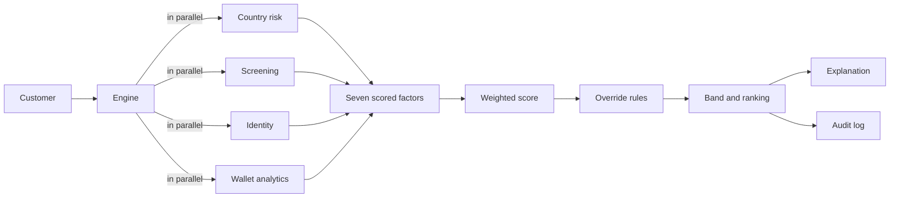

# KYC Risk Engine

An explainable customer risk scoring engine for know-your-customer (KYC) and anti-money laundering checks. It pulls signals from several data sources, scores seven risk factors, applies hard-stop rules, ranks customers for analyst review, and records an audit trail for every decision.

This is a clean-room reference implementation built from public regulatory guidance and industry material. It uses synthetic customers and mock data sources. It contains no employer code, data or configuration. Built with AI-assisted development (Claude).

## What it shows

- Product thinking for regulated finance: how a risk-based approach turns into configurable rules.
- Safe use of AI: the rules decide, and an optional AI layer only writes the explanation. It cannot change a score.
- Engineering basics: pluggable data sources, graceful failure, tests, and an audit log.

Market research behind the design is in [docs/market-discovery.md](docs/market-discovery.md).

An interactive companion, the [risk model playground](../risk-model-playground/), lets you change the weights, cut-offs and rules and see the effect on 300 synthetic customers.

## Quick start

```bash
pip install -e ".[dev]"
python -m kyc_risk_engine.demo
pytest
```

Demo output on the eight synthetic customers:

| Rank | Customer | Score | Band | Why |
|---|---|---|---|---|
| 1 | C005 | 74 | blocked | Confirmed sanctions match, mixer exposure |
| 2 | C004 | 49 | high | Foreign politically exposed person, floor override |
| 3 | C006 | 37 | high | Several elevated factors together |
| 4 | C008 | 29 | high | Near-miss name with a different birth date, needs analyst check |
| 5 | C003 | 31 | medium | Two elevated factors |
| 6 | C007 | 16 | medium | Identity provider outage, required data missing |
| 7 | C002 | 11 | low | Clean |
| 8 | C001 | 6 | low | Clean |

## How it works



1. Each data source sits behind one small interface. A failing source never crashes an assessment. It becomes "data unavailable".
2. Seven factors are scored 0 to 100: geography, screening, product, channel, identity, crypto exposure, customer profile. Weights live in `config/risk_config.json` and must sum to 1.
3. A weighted score gives a first band.
4. Override rules then raise the band. A weighted average must not hide a hard stop.
5. Customers are ranked by band, then score.
6. Each result carries the evidence for every factor. Each decision is logged with a fingerprint of the exact config used.

## Design decisions

- **Highest-risk touchpoint for geography.** Averaging would let a clean country of residence hide a risky counterparty country.
- **Override rules.** Confirmed sanctions match blocks. Foreign politically exposed person, a high-risk jurisdiction, a forged document, or mixer exposure sets a minimum of high.
- **Compounding rule.** Three or more elevated factors give high. Two give medium. Without this, several moderate risks were diluted to a low score in testing (see customer C006).
- **Missing data is not safe data.** A failed source gets a default score. If a required source is missing, the case goes to manual review.
- **Fuzzy name matching with birth date.** Matching ignores word order, accents and punctuation. A matching birth date raises confidence and a different one lowers it. Near matches go to an analyst instead of being auto-decided.
- **AI only explains.** `narrative.py` has a deterministic template by default and an optional Claude-based writer that receives only the structured facts.

## Limits (read before reusing)

- Weights, thresholds and country scores are illustrative. They are not an official risk list. A real firm must derive them from its own documented risk assessment and have the model independently validated.
- No dynamic re-scoring. Scores are computed on request, not on events.
- No transaction behaviour factor.
- Mock sources use fictional names and fixture files. Real vendor connectors are not included.
- The optional AI narrative needs a live API key and is not covered by the automated tests.
- Under the EU AI Act, a production system like this would need its own compliance review.

## Project layout

```
config/risk_config.json            weights, thresholds, lookup tables
data/                              synthetic customers and mock source responses
src/kyc_risk_engine/
  engine.py                        orchestration and override rules
  scoring.py                       pure scoring functions, one per factor
  connectors/                      data source interface and mocks
  narrative.py                     template and optional AI explanation
  audit.py                         append-only decision log
tests/                             12 tests covering rules, outages, ranking, audit
```

## Licence

MIT. See the repository root.
